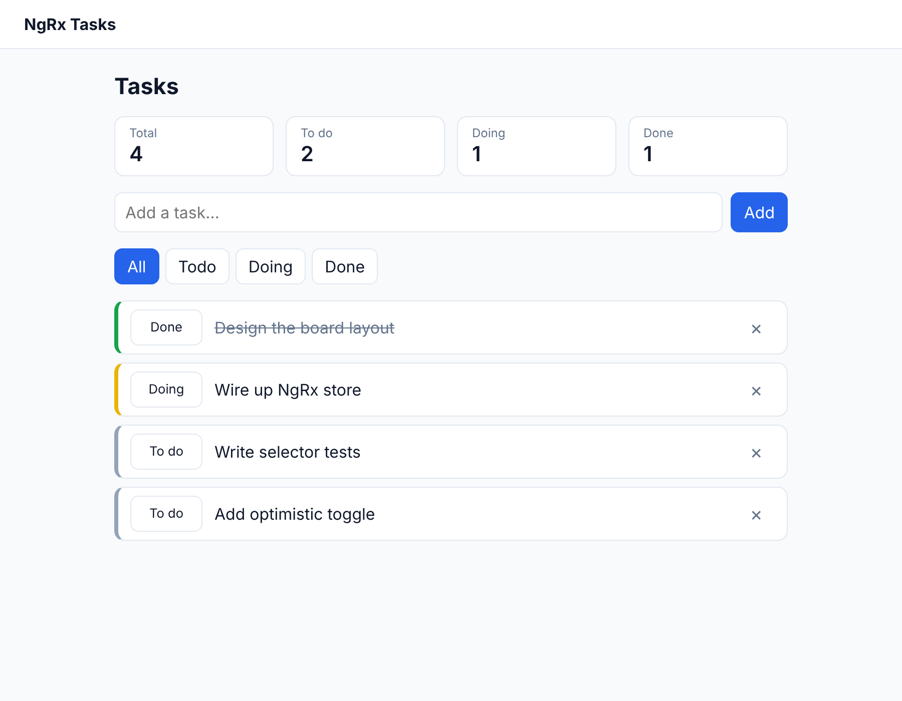

# Angular NgRx — Tasks

A focused Angular 19 app demonstrating **NgRx** the way larger Angular codebases manage state: a feature slice with an **entity adapter**, **action groups**, a pure **reducer**, **memoized selectors** (including derived state), and **effects** that isolate async work from the reducer.



## What it shows
- **`createFeature` + `createEntityAdapter`** — normalized `{ ids, entities }` storage with CRUD helpers and a sort comparer (`state/tasks/tasks.reducer.ts`).
- **`createActionGroup`** — namespaced, discoverable actions (`[Tasks] Load Tasks Success`, …).
- **Memoized selectors** — `selectFilteredTasks` combines the entity list with the current filter; `selectStats` derives per-status counts. Both are `createSelector`, so they recompute only when inputs change (there's a test asserting referential stability).
- **Functional effects** — `loadOnEnter$` turns a page-enter action into a load; `loadTasks$` calls the service and maps success/failure to actions, cancelling in-flight loads with `switchMap`.
- **Feature-based registration** — the root store is empty; the tasks feature registers its own slice and effects via `provideState` / `provideEffects`, the pattern you'd use when lazy-loading a feature.
- **Store signals in an OnPush component** — selectors are read via `store.selectSignal(...)`.

## State flow
```
Component ──dispatch──▶ Action ──▶ Reducer (pure) ──▶ Store
    ▲                      │                            │
    └── selectSignal ◀── Selectors (memoized) ◀─────────┘
                           │
                        Effects ──▶ TasksService (async) ──▶ Action
```

## Run it
```bash
pnpm install
pnpm start                 # http://localhost:4200
pnpm lint
pnpm test:ci               # headless Chrome (set CHROME_BIN if needed)
pnpm build
```
The NgRx DevTools are wired up, so the store is inspectable in the Redux DevTools extension.

## Testing
Karma + Jasmine, headless Chromium (13 tests):
- **Reducer** — loading/success/error transitions, the `todo→doing→done→todo` status cycle, add/remove via the entity adapter, filter updates.
- **Selectors** — filtering by status, stats counts, and that memoization returns a stable reference.
- **Effects** — `enterPage → loadTasks`, load success mapping, and failure mapping (service throws), using `provideMockActions`.

Reducers and selectors are pure, so most of the logic is tested without the DOM; only the effects touch Angular's injector.

## Trade-offs and limitations
- **Mock service.** `TasksService` returns seeded data with latency; swap it for an `HttpClient` implementation and the store is unchanged.
- Add/toggle/remove update the store directly (no persistence effect); a real app would add effects that write through to an API, likely optimistically.
- One feature slice — enough to show the NgRx building blocks without ceremony. NgRx shines as app state grows; for small local state, signals (see my other Angular projects) are lighter, and that choice is deliberate.
- No router-store or component-store here; those would be the next pieces in a larger app.

## License
MIT
